# Checked constructions, not an inclusion of quantum mechanics

Current companion to `conceptual-steps-table.md`. The previous diagram's
quantization and theory-inclusion arrows are withdrawn; its original is
preserved under `quarantine/20261007-conceptual-summary/`.

These are separate typed branches. Solid arrows name conditional constructions
or comparisons with the supplied inputs indicated. Dashed arrows mark physical
promotions not established here; they are not open waiting tasks or implications.

```mermaid
flowchart TD
  B["Existing full Bool Tick at fixed source"]
  B --> T["Full record classified by ordered schedule tags"]
  B -->|"Supplied complex linearization and metric"| U["Unitary Hamiltonian realization of its discrete square"]
  U -->|"Compare admissible analytic annotations"| N["Path-image uniqueness refuted in the declared class"]

  C["Declared Clifford metric, defining module and phase connection"]
  C --> P["Completed phase lift and HJ chart comparison; C = kappa"]
  P --> A["Affine angular clock with retained winding and orientation"]
  A --> K["Specified observations do not calibrate external rate or kappa"]
  P --> R["Closed lift does not quantize reduced action"]
  P -->|"Explicitly added angular cotangent pair"| TT["Regular parametrized constraint recovers the full form and phase"]
  GG["Actual four-point permutation action"] --> UU["Stabilizer covariance and canonical cotangent lift"]
  TT -.-> VV["No ADM field-constraint map or physical time inferred"]
  UU -.-> VV

  S["Existing six-port pulses, metric and full retained state"]
  S --> Q["Canonical chart retaining reference and internal pairs"]
  Q --> E["Shared recoil cotangent representation"]
  Q --> J["Old spatial reader plus recoil-only momenta: rank obstruction"]
  E --> J

  G["Supplied cubic grid and Euclidean dot product"]
  G --> D["Valid finite grid counts and direction Gram"]
  D -->|"Compare claimed radial reconstruction"| F["Fixed-point continuum convergence refuted for that interpolant"]

  O["Original complex S4 permutation-operator Gram"]
  O --> V["Rank-ten operator image; left and conjugation actions distinguished"]
  V -->|"Compare completed supplied witness sectors"| W["Explicit weak and charge lifts; existing pinching recovered"]
  W -.-> Y["No selected physical matter, hypercharge or kinetic law inferred"]

  AA["Existing twelve directed arrows with endpoint S4 action"]
  AA --> BB["Invariant block systems classified; unique four-arrow matching blocks"]
  BB -.-> CC["Independent S4 cubed action and physical generations not selected"]

  DD["Supplied full twelve-point numerical Gram with endpoint phases"]
  DD --> EE["Typed adjoint comparison: common doublet maps align; singular values fixed"]
  EE --> FF["Printed singlet-eigenframe CKM fails readout descent"]

  QQ["Complete five-filler source with ordered Bool labels"]
  QQ --> RR["Encoded record route: raw norm and click normalization distinguished"]
  QQ --> SS["Actual twist action plus existing X+ instrument prepares Bell conditionally"]
  RR -.-> M
  SS -.-> M

  U -.-> H["No selected physical Hamiltonian or time calibration inferred"]
  A -.-> H
  E -.-> X["Physical localization and mass calibration still need independent input"]
  P -.-> M["No Born rule, action quantum or detector record derived"]
```

The period/action arrow is resolved by
`rotor-period-does-not-quantize-reduced-action.md`, using the completed phase
lift rather than its earlier zero-offset mismatch. Evidence for the other nodes
and their exact scope is indexed in `conceptual-steps-table.md`.
